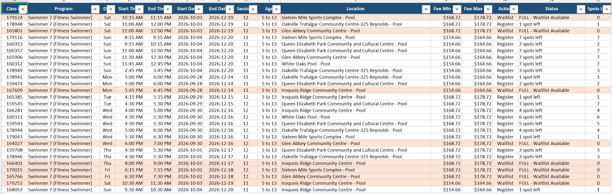

It's Saturday morning, and I'm at the Burlington library. I dropped the kids off at Red Coat, and while they're there I'm enjoying some time entirely to myself in the library next door. My wife has a part-time shift, so I dropped her off at the community centre on the way.

I'm sitting here quietly thinking. How is my life these days? How can our family live more happily and healthily? Is there a way to automate some of the activities we repeat over and over?

On Thursday I went to my daughter's basketball game, and her performance was so far off that I was taken aback. She missed six layups, got beaten on defence again and again, and kept losing the ball while dribbling. When I asked her afterwards, she said she was out of breath and it was really hard. Thinking about it, the difference from before is that her activity level dropped sharply once she hit grade 7. She used to do three or more sports a week, like basketball, swimming, volleyball and taekwondo, but now it's just one basketball session a week, so it's no wonder.

My son ran for his school in a race this morning. It was a meet with kids from all over Halton, but he still came in 53rd.

Both of them clearly need more exercise, so I talked it over with my wife. Let's sign them up for Swimmer 7 at the community centre. My daughter already finished Swimmer 10 and earned her Bronze Medal and Stars, but a Swimmer 7 class, which aims at physical fitness by swimming back and forth for a full hour, seems like a good idea for her again. I asked the aside browser to turn the current Swimmer 7 availability at the community centre into a spreadsheet.

When my wife finishes work, we'll go through it together and register both kids at the same place.

My wife and I have also both lost a lot of stamina, so we started Zumba again yesterday. We followed a YouTube video in the basement for about an hour, and it was fun to exercise together after such a long time. I must remember to do it together again today. While we're at it, I'm thinking of filming a tap dance video and posting it as a Short. I'll experiment with a few things later.

It's almost 10:40 already. Before I go pick up the kids, I need to hurry and get my presentation for next week's book club in order.
